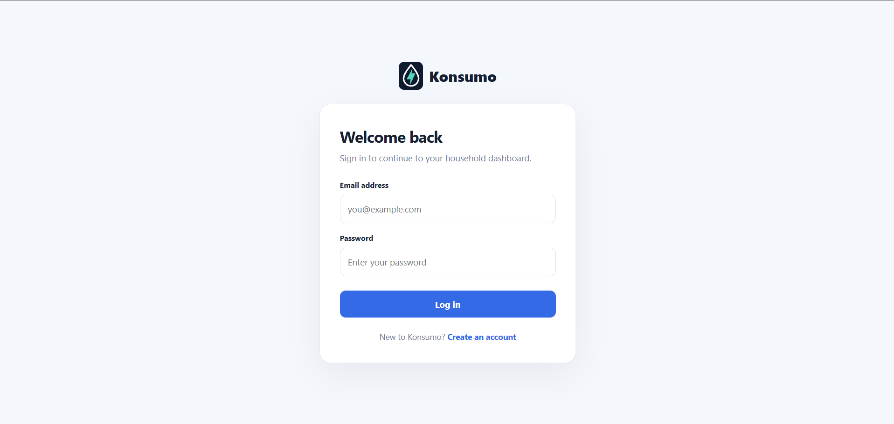
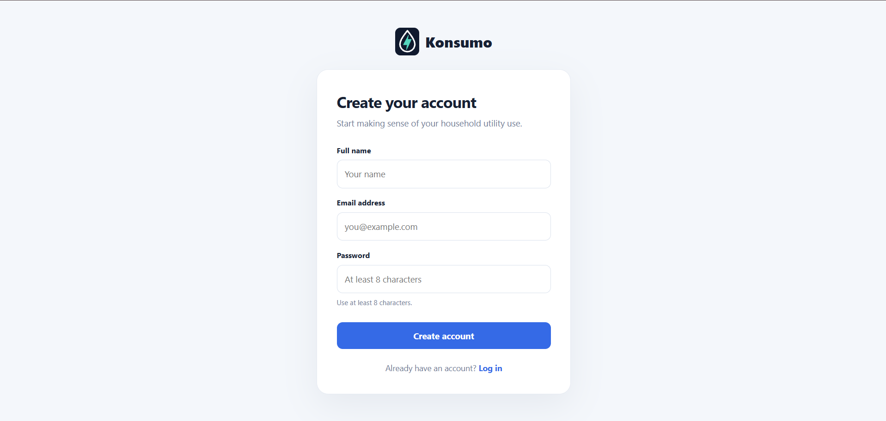
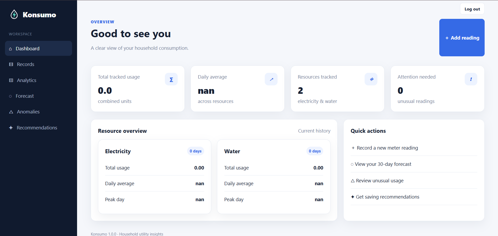
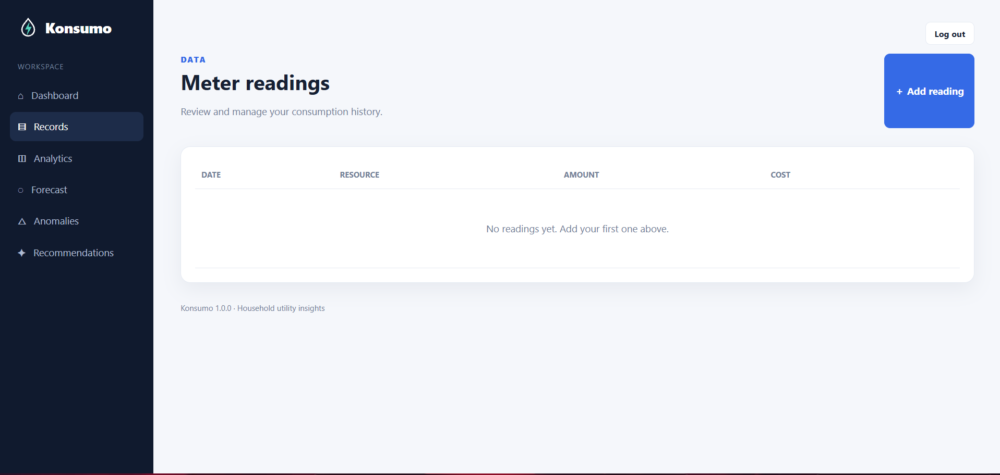
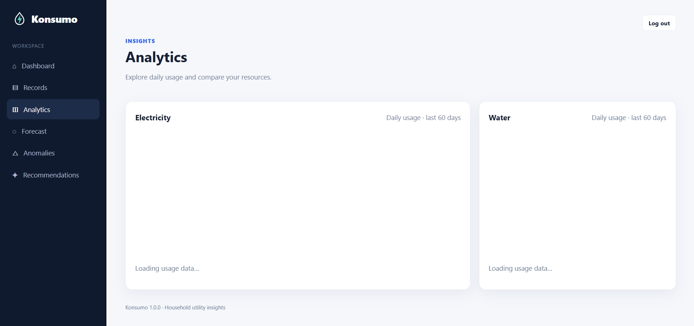
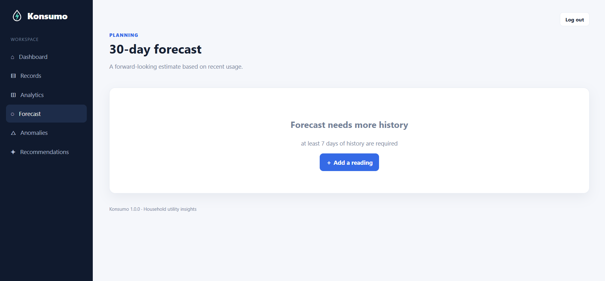

<p align="center">
  
  <h1 align="center">Konsumo</h1>
</p>
<p align="center">
  <strong>A household utility monitoring and consumption analytics dashboard</strong>
  <br />
  Track electricity and water usage, understand household consumption patterns, and make more informed decisions about utility costs.
  <br /><br />
  <a href="https://konsumo-2.onrender.com"><strong>🌐 Live Demo</strong></a>
  ·
  <a href="https://github.com/joshuaarao42-arch/KONSUMO/issues">Report a bug</a>
  ·
  <a href="CONTRIBUTING.md">Contributing</a>
</p>

---

## Overview

**Konsumo** is a Python-based household resource monitoring application focused on electricity and water consumption. It provides a central place to record meter readings, review usage history, estimate costs using configurable tiered tariffs, identify unusual readings, and explore short-term forecasts.

The project combines a lightweight web dashboard, a SQLite database, analytics modules, a JSON API, and a command-line interface. Its web server is built with Python's standard-library `http.server`, keeping the application small and straightforward to run.

| | |
|---|---|
| **Live application** | [https://konsumo-2.onrender.com](https://konsumo-2.onrender.com) |
| **Repository** | [joshuaarao42-arch/KONSUMO](https://github.com/joshuaarao42-arch/KONSUMO) |
| **Language** | Python 3.10+ |
| **Database** | SQLite |
| **Interface** | Server-rendered web dashboard and CLI |

## Features

### Household consumption records
- Add electricity and water meter readings with a date, amount, and optional notes.
- Review recorded consumption in the records page.
- Edit and delete existing readings.
- Store readings locally in SQLite.

### Tariff-based cost estimation
- Calculate estimated costs using configurable tiered rates.
- Use the calculated cost by default or provide a cost override for a reading.
- Change tariff tiers and currency in `konsumo/config.py`.

### Analytics and insights
- Aggregate readings into daily and monthly consumption series.
- Review summary statistics such as total usage, daily average, and peak usage.
- Compare recent monthly consumption.
- View usage charts in the analytics dashboard.

### Unusual-usage detection
- Identify readings that differ significantly from the historical average.
- The current detector uses a z-score threshold of 2.5.
- Review flagged dates, usage amounts, and estimated cost impact.

### Short-term forecasting
- Generate a 30-day usage projection for electricity and water.
- The current forecast combines a recent moving average with a linear trend.
- Forecasting requires at least seven days of recorded daily history.

### Recommendations
- Generate household-saving suggestions using available consumption patterns.

### Account access
- Create an account through the signup page and sign in through the login page. Multiple accounts are supported.
- Passwords are stored as salted PBKDF2-HMAC-SHA256 hashes rather than plain text.
- Browser sessions use server-side session records and an HTTP-only cookie.
- Each account has its own isolated household readings, analytics, forecasts, and recommendations. Users cannot view, edit, or delete another account's records.

## Screenshots

<table>
  <tr>
    <td width="33%" align="center">
      <strong>1. Login</strong><br />
      
    </td>
    <td width="33%" align="center">
      <strong>2. Sign Up</strong><br />
      
    </td>
    <td width="33%" align="center">
      <strong>3. Dashboard</strong><br />
      
    </td>
  </tr>
  <tr>
    <td width="33%" align="center">
      <strong>4. Records</strong><br />
      
    </td>
    <td width="33%" align="center">
      <strong>5. Analytics</strong><br />
      
    </td>
    <td width="33%" align="center">
      <strong>6. Forecast & Insights</strong><br />
      
    </td>
  </tr>
</table>

## Technology Stack

| Technology | Purpose |
|---|---|
| Python 3.10+ | Application language |
| `http.server` | Lightweight HTTP server and request handling |
| SQLite | Persistent relational data storage |
| pandas | Time-series aggregation and data handling |
| NumPy | Numerical calculations and forecasting |
| Matplotlib | Chart-generation utility |
| HTML and CSS | Dashboard and authentication page presentation |

The browser dashboard is served by the Python application. The project does not require a separate frontend build process.

## Getting Started

### Requirements

- Python 3.10 or newer
- pip
- Git (for cloning the repository)

### 1. Clone the repository

```bash
git clone https://github.com/joshuaarao42-arch/KONSUMO.git
cd KONSUMO
```

### 2. Create and activate a virtual environment

**Windows (PowerShell):**

```powershell
python -m venv .venv
.venv\Scripts\Activate.ps1
```

**Windows (Command Prompt):**

```bat
python -m venv .venv
.venv\Scripts\activate.bat
```

**macOS / Linux:**

```bash
python3 -m venv .venv
source .venv/bin/activate
```

### 3. Install dependencies

```bash
python -m pip install --upgrade pip
pip install -r requirements.txt
```

### 4. Start the application

```bash
python run.py
```

Open [http://127.0.0.1:5000](http://127.0.0.1:5000) in your browser. Use the signup page to create an account. Each account receives a separate, private household dataset.

### 5. Add demo data (optional)

To populate one account with sample consumption readings, first create an account and find its numeric ID in the `users` table, then run:

```bash
python -m konsumo.cli seed --user-id 1
```

If the web server is already running, refresh the records or dashboard page to view the inserted data.

## Using the Application

1. **Create the initial account** on the signup page when using a fresh database.
2. **Sign in** with the email and password associated with that account.
3. **Add meter readings** for electricity or water, including the reading date and amount.
4. **Review records** to check, edit, or remove saved entries.
5. **Open Analytics** to inspect daily usage charts and summary patterns.
6. **Check Anomalies** to identify unusual consumption readings.
7. **Open Forecast** to view the 30-day projection when enough history is available.
8. **Review Recommendations** for suggestions based on recorded usage.

## Command-Line Interface

Konsumo includes a small CLI for database setup and starting the web server.

Seed the database with sample readings:

```bash
python -m konsumo.cli seed
```

Start the web server through the CLI:

```bash
python -m konsumo.cli serve
```

The seed command requires `--user-id` to ensure sample records belong to a specific account. The CLI also accepts options:

```bash
python -m konsumo.cli serve --host 127.0.0.1 --port 5000
python -m konsumo.cli serve --db ./data/konsumo.sqlite3
```

You can also launch the application using `python run.py`, which reads the `PORT` environment variable when available (useful for hosting platforms).

## JSON API

The application exposes JSON endpoints for consumption data and cost estimates. These endpoints are protected by the same login/session requirement as the dashboard.

| Endpoint | Method | Description |
|---|---|---|
| `/api/daily/<resource>` | GET | Daily usage series; supports optional `?start=YYYY-MM-DD` |
| `/api/monthly/<resource>` | GET | Monthly usage and cost summary |
| `/api/forecast/<resource>` | GET | Forecast points, recent history, and forecast metrics |
| `/api/stats/<resource>` | GET | Summary statistics for a resource |
| `/api/quote` | POST | Estimate tariff cost from a resource and amount |
| `/api/seed` | POST | Add sample readings to the database |

The supported resource values are `electricity` and `water`.

Example request for a tariff quote:

```bash
curl -X POST http://127.0.0.1:5000/api/quote \
  -H "Content-Type: application/json" \
  -d '{"resource":"electricity","amount":120}'
```

For authenticated API requests, send a valid session cookie obtained after signing in.

## Configuration

Application defaults are defined in `konsumo/config.py`.

- **Database path:** `DEFAULT_DB_PATH` (defaults to `konsumo.sqlite3` in the project root).
- **Currency:** `CURRENCY` (currently `PHP`).
- **Tariff tiers:** `TARIFFS` (separate tier definitions for electricity and water).

The default tariff values are example configuration values. Review and replace them with the rates applicable to your utility provider before relying on cost estimates.

## Project Structure

```text
KONSUMO/
├── konsumo/
│   ├── __init__.py
│   ├── analytics.py          # Usage aggregation, cost calculation, anomaly detection
│   ├── cli.py                # Command-line entry point
│   ├── config.py             # Database path, currency, and tariff settings
│   ├── database.py           # SQLite schema and database connections
│   ├── forecasting.py        # 30-day usage forecasting
│   ├── recommendations.py    # Consumption-based recommendations
│   ├── repository.py         # Consumption record data operations
│   ├── seed.py               # Sample data generation
│   └── web/
│       ├── app.py             # HTTP routes, pages, and JSON API
│       ├── auth.py            # Account authentication and sessions
│       └── views.py           # HTML templates and styling
├── scripts/
│   └── generate_charts.py     # Static chart-generation utility
├── patches/                   # Development patch/reference files
├── requirements.txt
├── run.py                     # Main application launcher
├── CONTRIBUTING.md
├── LICENSE
└── README.md
```

## Deployment

The live application is hosted on Render:

**[https://konsumo-2.onrender.com](https://konsumo-2.onrender.com)**

For a Render Web Service, use the following settings:

| Setting | Value |
|---|---|
| Runtime | Python |
| Build command | `pip install -r requirements.txt` |
| Start command | `python run.py` |

Render supplies the `PORT` environment variable, which `run.py` reads automatically.

### Important: database persistence

The default SQLite database is stored beside the application code for local development. On Render, attach a persistent disk to the web service (for example, mount it at `/var/data`) and set the environment variable `KONSUMO_DB_PATH=/var/data/konsumo.sqlite3`. Redeploy after saving the setting. The application creates the database directory if needed. Without a persistent disk, accounts, sessions, and consumption records can be lost when the service is restarted or redeployed.

The application supports multiple accounts. Every consumption record is linked to its owner, and all dashboard pages, analytics, forecasts, recommendations, and JSON endpoints filter by the authenticated account. Existing records in an upgraded database are assigned to the first account created after the upgrade.

## Development and Contribution

Contributions, bug reports, and improvement suggestions are welcome. Before submitting a change:

1. Read [CONTRIBUTING.md](CONTRIBUTING.md).
2. Create a focused feature or fix branch.
3. Keep business logic separate from the web presentation layer.
4. Include or update tests when changing application behavior.
5. Include screenshots when changing the user interface.
6. Open a pull request describing the change.

The repository currently does not include a dedicated automated test suite, so changes should be manually verified until tests are added.

## Current Limitations

- Only electricity and water resources are supported.
- Each registered account has a separate household workspace; there is no shared-household invitation feature yet.
- There is no password-reset or email-verification workflow.
- Forecast quality depends on the amount and consistency of recorded history.
- Cost estimates depend on the tariff configuration and may not match a provider's complete bill, taxes, fees, or adjustments.
- Persistent storage must be configured on the hosting platform to retain production data.

## Roadmap

Potential future improvements include:

- CSV import and export for meter readings.
- Multiple households, users, and meters with data isolation.
- Budget limits and consumption alerts.
- Additional resources such as gas.
- Expanded automated tests and reporting.
- More detailed tariff configuration and bill breakdowns.

## Author

**Joshua Arao**  
Computer Science Student  
University of Science and Technology of Southern Philippines

## License

This project is distributed under the [MIT License](LICENSE).
